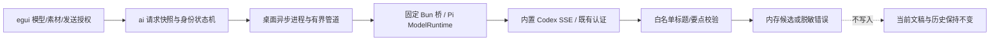
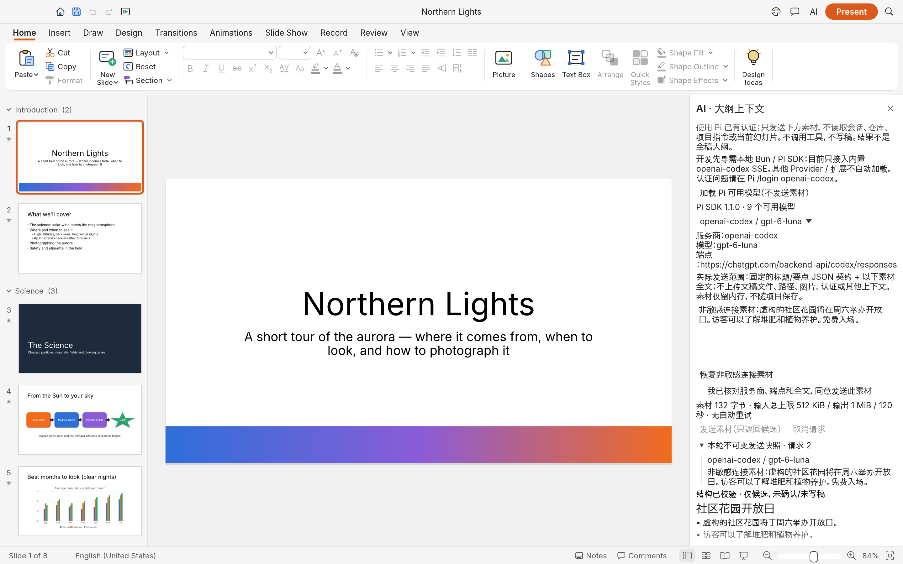

# #15 A — 最小真实 AI 入口检查点

> 历史证据，不是当前产品启动流程。用户已要求统一聊天与 PPT 工作区；模型接入作为底座保留，旧“连接 → 独立归纳确认 → 改页 → 新建”路线已撤销。后续按 [最新 RFC](rfcs/ai-assistant.md)、[迁移计划](ai-unified-workspace-plan.md) 与 #10 执行。以下操作链和 A/B 分期仅作为历史记录。

实施分支：`feat/ai-minimal-entry`，基于 `checkpoint/ai-context-extraction@76b198e`（旧工程检查点 `7ae7951`，未合 main）。本轮仅做 A；**等待人工产品验收**，不关闭 #15，不实施 #20 / #15 B / #12。没有启动子代理，没有发送用户文稿，没有读取/输出/复制认证内容。

## 已交付边界



`Idle → Running → ModelsReady / Candidate / Failed / Cancelled`。终态只接受本轮 requestId 与请求种类；取消、关闭来源文稿或超时后迟到结果无效。切标签不换目标；一宿主最多一个桥进程，上一请求清理结束前拒绝再次启动。素材输入可无文稿/确认大纲，#20 可以直接复用，而不是复用 `Round::from_confirmed` 前置。

- `crates/ai/src/request.rs`：严格契约、大小限制、错误白名单和生命周期，以及 `Host` 平台接口；不写 Session。
- `apps/deckcraft/src/ai_host.rs`：固定目录/脚本、无 shell、异步 stdin/stdout、超时/取消/回收；stderr 不转发。
- `scripts/ai/pi-bridge/`：SDK 1.1.0 `ModelRuntime`，无 AgentSession/资源发现/工具；共享输入、上游 HTTP、归一化内容及 IPC 限额；SDK 自行刷新/锁定原认证。
- `crates/ui-egui/src/ai_pilot.rs`：显式模型选择、端点/全文发送范围、逐轮同意发送、请求/取消、快照、候选/错误展示。不发网络、不保存凭据、不写文稿。旧摘录核对入口收起为未验收历史功能。
- Web 无本地适配器，有明确提示；普通编辑、Rust-only CI 与 WASM 保留可用。

## 真实证据（非敏感固定素材）

本机 Bun **1.4.2** / Pi SDK **1.1.0**。

- 直接桥 smoke：`openai-codex / gpt-6.1-sol`，虚构花园素材，成功返回并校验受限标题/要点。
- 收尾受限传输版本重新运行：

```sh
bun --no-env-file --no-install scripts/ai/pi-bridge/smoke.ts --live gpt-6.1-sol
# {"sdkVersion":"1.1.0","provider":"openai-codex","model":"gpt-6.1-sol","validation":"passed"}
```

此脚本只记录上述元数据，不记录结果正文/认证/HTTP 头。首轮代码曾误用未刷新的 `hasConfiguredAuth` 快照，产生 auth 状态；已改为 SDK `getAvailable/getAuth`，之后真实 smoke 成功。不是凭据迁移或 HTTP/OAuth 替代方案。

本轮启动真实 App：

```sh
DECKCRAFT_NO_RECOVERY=1 DECKCRAFT_NO_PREFS=1 DECKCRAFT_NO_AUDIO=1 \
  target/debug/deckcraft --sample --control 7995
```

加载模型后，本轮实际桌面画面中可见 **openai-codex / gpt-6-luna** 的真实候选、不可变素材快照和“结构已校验 / 未写稿”状态；左侧仍是内置 Northern Lights 原页。截图仅包含内置样本与虚构素材，无个人文稿/凭据。采集时面板顶部尚保留旧标题“AI · 大纲上下文”，收尾已改为“AI · 模型连接”；截图不是最终像素回归基准。



以上证明连接和受限结果进入桌面，不证明归纳质量、改页质量或用户已经验收；本轮尚无明确人工验收反馈。

## 自动验证

- `bun test scripts/ai/pi-bridge`：6 个离线测试；字段白名单、坏 JSON、工具调用、推理/上游超限、取消传播、共享 HTTP 预算、无重试、状态脱敏。
- `cargo test -p deckcraft-ai --lib`：12 个通过，含请求身份、乱序/重复/迟到、取消、输入预算、请求种类校验。
- `cargo test -p deckcraft-ui-egui --lib`：20 个通过，1 个旧 GPU 证据测试默认忽略；包括实际 egui 模型选择/同意/发送/结果的 Fake 回归；未同意禁止发送、关闭文稿丢弃迟到结果、文稿不变与 Web 不可用提示。
- `cargo test -p deckcraft ai_host --bin deckcraft -- --ignored`：显式运行 Bun-only 子进程回归，通过；阻塞写入、取消、期限、退出、坏 JSON、身份伪造、stdout 超限。无需 Pi/认证/网络；默认 Rust CI 不依赖 Bun。
- 本轮重跑 `cargo test`、`cargo test -p xtask`、`cargo fmt --check`、`git diff --check`、`cargo clippy --all-targets -- -D warnings`、`cargo xtask layers`、`cargo xtask wasm`。旧忽略的 GPU/性能测试没有重跑；离线测试不冒充真实产品验收。

## 试用与后续

`cargo run -p deckcraft -- --sample` → 右上 **AI** → 加载模型 → 选模型 → 核对端点和下方素材 → 勾选同意 → 发送 / 取消。无需旧摘录确认。只发送输入框全文和固定结果契约，不发送画布、文件、图片、路径、会话或项目指令。候选不写稿，不随原生项目保存。

没有人为失效个人 token 或真实模拟限流/网络故障；刷新/错误路径依据 SDK 源码走查与离线 mock，不冒称做过这些真实故障验收。

当前限制：仅已审查的内置 Codex SSE、SDK 1.1.0 和本地开发安装布局；不加载 models.json / 扩展 Provider，不是全 Rust 独立分发；宿主使用构建时固定源码脚本目录，打包发布仍待决策。其他 Provider/SDK 版本明确不可用。SDK/凭据命令是受信任本地代码，不是 OS 沙箱；模型/刷新 HTTP 响应在 SDK 缓冲前受限，但不宣称整个 Bun 进程有 OS 内存配额。取消不能承诺服务商退还已经执行的费用。详细运行/协议/审查见 [桥 README](../scripts/ai/pi-bridge/README.md)。

请人工核对：模型与发送范围是否明确、发送和取消是否可操作、候选与错误是否易理解。得到 A 可用反馈后，下一项是 #20 全稿归纳与新版大纲语义；#15 B 必须继续等待 #20 的依据/大纲契约和人工质量验收。

关键决策：先用一个已审查的真实传输贯通入口，避免凭据跨端点与未审查 SDK 缓冲；请求结果止于内存候选，保留唯一 engine 写入边界，不偷渡旧摘录语义或新大纲产品验收。
