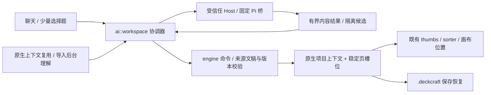

# M1：#20 + #12 共同工作区

状态：**至共同页计划的工程切片已实现，真实模型质量与人工体验待验收**。没有生成整份 PPT，没有实施 M2 改页/成稿或 M3 外部任务 API；没有关闭 issues、提交代码或调用付费模型。

本轮开始时已存在的未提交修改先备份到 `/tmp/deckcraft-m1-backup/before.patch` 与 `untracked.tar.gz`，再迁移旧 UI/测试。原有桥、安全校验、旧持久字段与兼容 engine 命令仍保留；正常 UX 不再走“提取—归纳—暂存/确认”操作台。

## 可运行路径

`cargo run -p deckcraft`，创建/打开文稿，点击右上 **AI**：
- 模型列表自动加载，不上传文稿。选择模型后，按文稿启用一次运行期数据使用授权；换模型撤销授权，不要求每轮检查快照/JSON。
- 空文件输入模糊主题，在聊天内回答用途、受众、规模（3–12 页）选择题；可用“其他/补充”。生成的**页计划**直接进入当前文件原 thumbnails/sorter，不创建生成器或新标签。
- 导入文稿原页立即保留可见；授权后后台读取全部有界文字并理解主线/逐页职责。原缩略图附简要意图，不改原页形状或文字；空页/图片等缺口仍标未知。
- 已保存原生上下文通过版本、字段与当前文字依据校验后复用，不调用模型。缺少有效上下文的旧项目重新准备；手改/新增/删除/排序/Undo/Redo 自动检查当前依据，保留已采用的表达方向。
- 页列表右键调整意图，计划页画布位置也可编辑。排序/删除沿用原命令；页 ID 不随顺序变化。排序视图仍保留同一个聊天入口。
- 一次新建页计划任务一次原子 Undo；后台来源刷新不新增用户历史，也不刷聊天总结。关闭来源文稿、取消或失败不能复活迟到结果；切标签不换目标。手改/未结束拖动造成冲突时按文稿保留隔离候选，不覆盖，提供“按当前文稿重新组织”。
- `.deckcraft` 保存已组织的需求、当前依据、主线、各页意图与计划/原页状态。未展开计划页不允许 PPTX/PDF/图片成品导出或放映；仅含原页的 PPTX 导出仍不把 AI 元数据标记为原生已保存。

## 模块与状态边界



- `crates/ai/src/workspace.rs`：每文稿对话、澄清策略、快照、上下文复用/更新、任务身份、取消/冲突、真实动作与最终总结。只收只读文稿视图，返回受限 engine 效果，不持有可变 `Session` 或 I/O。
- `crates/ui-egui/src/ai_pilot.rs`：宿主主循环适配及聊天投影；UI 只留输入缓冲，不拥有原文快照/任务编排。`page_plan.rs` 在原页位置展示与调整。
- `crates/model/src/workspace.rs`：需求、表达计划、项目版本/来源，以及 `Slide.ai_plan` 的显式 `Planned / Existing` 状态。计划槽位有宿主分配的 `SlideId`，**无正文形状**，不是伪装成稿的空白页。
- `crates/engine/src/workspace.rs`：`ai.installWorkspace` / `ai.adjustPageIntent` 校验与提交。已有页形状不被导入理解写回；原页新增意图保留未知，不提升为来源事实。计划分配 checked ID，采用有效布局，原生恢复不改变槽位。
- 固定桥新增 `plan` 严格结果契约，仅返回主线/标题/意图；不接受模型分配 ID、状态或任意命令。保留 512 KiB 输入、1 MiB 输出/上游 HTTP、120 秒、无工具、无自动网络重试等边界。

`Waiting → Clarifying → Preparing → Ready` 与导入 `Waiting → Preparing → Ready` 汇合；`Failed / Cancelled / Conflict` 不安装模型结果。真实执行状态来自请求启动、结果校验和 engine 回执，没有假进度或模型原始推理。

## 本轮实测

| 门禁 | 结果 |
|---|---|
| `cargo fmt --check` | 通过 |
| `cargo clippy --workspace --all-targets -- -D warnings` | 通过 |
| `cargo test --workspace` | 561 passed、0 failed、3 ignored（含 doc-tests） |
| `cargo xtask layers` | 28 crates，0 violations；依赖边界未改变 |
| `cargo xtask wasm` | 23 个要求包全部通过 |
| `bun test scripts/ai/pi-bridge/protocol.test.ts` | 8 passed、67 assertions，无 SDK/认证/网络 |
| `cargo test -p deckcraft ai_host --bin deckcraft -- --ignored` | 1 passed，离线 Bun 假桥进程的取消/退出/身份/超限/超时 |
| 显式离线 UI 渲染测试 | 1 passed，四张工作区截图与两个公共原生夹具 |
| `git diff --check` | 通过 |

新增/迁移测试覆盖：两种起点汇合、首次授权前不上传、不额外创建标签、页数/结果种类/ID/版本/溢出校验、任务单次撤销、原位排序/调整/删除、原生重开复用、手改来源更新且无历史/聊天噪声、取消/关闭/跨标签/迟到、隔离冲突、进行中拖动、无桥/超限、直接 PPTX/PDF/渲染导出阻断。

完整 workspace 默认跳过的另一个测试为既有 codec 性能测试；不是本功能缺失验证。桥和视觉 ignored 项本轮分别显式执行。

## 视觉证据（全部是假模型公共夹具，不是模型质量证据）

- [聊天中的需求选择](evidence/ai-m1/01-clarification.png)
- [当前文件的计划页与原位意图编辑](evidence/ai-m1/02-planned-normal.png)
- [排序视图计划页与同一个聊天入口](evidence/ai-m1/03-planned-sorter.png)
- [导入原页、当前画布与原列表概括](evidence/ai-m1/04-imported-normal.png)

检查发现并修复：计划页初始缺省布局会被原生修复器改写，已改用真实有效布局并增加往返测试；首次截图的 sorter 隐藏聊天，已补同一个 AI pane 并重新渲染；澄清补充输入提示误把所有问题当页数，已按问题改提示。截图重新检查了计划态标识、原位编辑、原页内容、概括位置和 sorter/聊天衔接。

复现（不调用真实模型）：

```sh
cargo test -p deckcraft-ui-egui render_two_start_workspace_evidence -- --ignored
# 默认输出 /tmp/deckcraft-m1-evidence/；可用 DECKCRAFT_M1_EVIDENCE_DIR 改目录
cargo run -p deckcraft -- /tmp/deckcraft-m1-evidence/public-planned.deckcraft
cargo run -p deckcraft -- /tmp/deckcraft-m1-evidence/public-context.deckcraft
```

## 未验收及留给后续的边界

- 没有发送真实文稿，没有运行任何 live smoke；归纳主线、选择策略与新建计划的真实质量需要明确授权后，由人连续体验两个起点。自动测试/截图不是产品认可，不关闭 #20/#12。
- M1 澄清是受限本地策略：用途/受众/规模、推荐项与补充，不宣称模型已能自适应理解任意完整需求。已形成计划的项目保存结构化需求；**未完成的澄清、聊天记录及冲突候选只在运行期**，关闭后不恢复。
- 图片/表格/图表/备注/OCR 未理解；只处理有界文字。没有自动分段或截断后冒称全稿理解。
- 已就绪项目的后续聊天明确告知当前只支持页计划与原位调整，不声称执行成稿/改页。隔离候选目前只提供基于当前文稿重新组织，不提供强制覆盖或复杂合并。
- M2 将沿用同一个页 ID 把 `Planned` 展开成真实原生页、支持现有页修改、渲染/溢出校验与一次任务安装；M3 才定义统一外部任务/授权 API。

关键决策：复用现有页容器/命令与稳定 ID，但用显式计划态和导出门禁区分“意图”和“真实页面”；共享协调层持有生命周期与来源缓存，UI 不重建两套新建/导入 runtime，后台派生更新不变成用户操作台。
