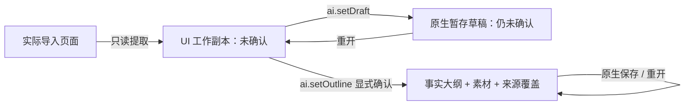

# #13 检查点：离线提取与核对底座 — 产品流程需修订

> 历史工程记录。#13 已按 superseded / not planned 归档，不是产品完成。底座由 #20 复用；新路线为 #20 + #12 共同工作区 → #15 共享执行 → #18 外部入口。以 [最新 RFC](rfcs/ai-assistant.md)、[迁移计划](ai-unified-workspace-plan.md) 与 #10 为准，不执行下方历史启动语或独立大纲确认流程。

基线：`main@0661aa2`。封存分支：`checkpoint/ai-context-extraction`。本检查点保留当前实现、测试和图像，不合入 main，不代表产品验收通过。没有启动子代理、访问模型或实现真实 AI 入口。

## 产品评估结论与后续边界

用户评估后确认：原文提取是合理底座，但摘录不是大纲。当前 `extract_context` 直接把段落复制为 `title/points`，确认后转为 `Outline`；缺少结合全稿提炼每页意图的模型步骤。原 #13 的离线“大纲确认”验收目标需要修订，而不是让用户人工整理整稿后才能使用 AI。

后续顺序：复用 [#15 A](https://github.com/hyperlook/deckcraft/issues/15) 接通最小真实模型入口 → [#20](https://github.com/hyperlook/deckcraft/issues/20) 全稿原文依据生成简要候选大纲 → 用户修正确认 → #15 B 单页改写／#12 新建。归纳大纲不能要求先有已确认大纲；原文依据、表达计划和最终页面文案必须区分。

本检查点不改变现有运行行为，旧 `Outline` 可能仍含全文摘录。接受页面提案后将完整正文回填 `Outline` 的既有行为也需后续校正。原生保存恢复已有实现，但普通保存 PPTX 不保证 AI 元数据，跨次重开外部文件也没有明确缓存关联策略。后续以 `.deckcraft` 项目保存、PPTX 导出为最小方向，不预建全局文稿库。

## 本次封存实际验证

- `cargo fmt --check`、`git diff --check`：通过。
- `cargo test`：通过；没有运行默认忽略的 GPU 证据渲染测试，没有访问真实模型。
- `cargo test -p xtask`：24 passed。
- `cargo clippy --all-targets -- -D warnings`：通过。
- `cargo xtask layers`：28 crates，0 violations。
- `cargo xtask wasm`：23 个受检 crates 全部通过。
- 可选 `craft-fonts` checkout 缺失仍为构建 warning，不是门禁失败；未安装依赖。

以下试用路径、接口和图像描述保留为原实现记录，不作为新大纲流程的产品验收证据。

## 试用路径

```bash
cargo run -p deckcraft -- /path/to/your.pptx
```

也可正常启动后用 Open 选择自己的 PPTX。点击窗口右上角 **AI**：

1. 左侧原页与右侧候选并排；点击卡片的页号定位原页。页号仅供显示，绑定使用当前文稿 `docUid` 和稳定 `pageId`。
2. 修改候选标题 / 要点；来源折叠区保留原始摘录及 shape 路径、段落。图片 / 图表 / 空页等的未理解部分有明确诊断，可标未知或补充说明，不要求重写其他页。
3. 可补充用途、受众、笔记、图片说明；桌面宿主支持选择 UTF-8 txt/md。素材正文可预览、编辑、移除。确认或暂存前显示原生文稿持久化隐私提示。
4. 滚动到侧栏底部：统一确认、暂存未确认草稿，或取消本次编辑。有缺口时先勾选有限上下文知情项。已删除页需先从工作副本移除。
5. 确认只保存依据，不改幻灯片；Undo/Redo 恢复整个确认动作（包括素材、来源和草稿状态）。暂存不会更新确认事实；取消不写入文稿。
6. **Save As → `.deckcraft`**，重新打开，核对已确认依据或仍标未确认的草稿。不要用 PPTX 导出来验证 AI 元数据持久化。
7. 已确认内容默认复用。手改原页不反写依据；显式重新提取后，各页展示将覆盖的原确认内容与新工作副本，必须再次确认。

原流程未获产品认可：用户指出原文摘录与大纲混用，转入需求修订。下列检查仍可用于验证提取与保存底座，但不能替代全稿归纳质量验收。

## 状态与写入边界



实际接口：

- model：新增 `ContextDraft`、`ContextPage`、`ContextSource`、`ContextDiagnostic`；`Presentation.contextDraft` / `confirmedContext` 为兼容可选字段，旧文件缺字段时为空。
- ai：`extract_context(&Presentation)` 有界只读提取；`review_existing` 恢复草稿或复用确认内容，不从手改页面静默更新事实。普通文本框采用首段标题候选；标题占位符优先；组合保留 ancestry。来源与编辑内容分离，不把摘录叫做模型理解。
- engine：`ai.setDraft {docUid?, draft: context|null}`；`ai.setOutline` 新增可选 `context`，核对 `pages == context.outline()`，原子安装确认依据 / 素材 / 元数据并清理暂存草稿。既有 `ai.setMaterials` 保留。所有持久化写入均经过命令、校验、panic guard 和历史。
- ai：`Round::from_confirmed` 只采用已确认大纲和素材；目标页没有确认标题时返回 `MissingContext`，即使草稿或页面有文字也不成为事实。
- UI：右上 AI 入口、真实画布旁核对面板、逐文稿工作副本。宿主 `Services.pick_material` 仅交付 basename + UTF-8 正文，文件选择及有界读取在桌面宿主。
- 层级：只开放 `ui-egui → ai` 的精确 L6 同层边，正反例测试保留对其他横向边的拒绝。

主要改动文件：`crates/model/src/context.rs`、`lib.rs` 的 Presentation 持久化字段及 `defaults.rs`、`crates/ai/src/context.rs` / `round.rs`、`crates/engine/src/{ai_apply,ai_contract,context_tests}.rs` / `cmd/ai.rs`、`crates/format/src/lib.rs`、`crates/ui-egui/src/{assistant,lib,panes,ribbon,theme}.rs` / Cargo.toml、`apps/deckcraft/src/{main,material}.rs`、`xtask/src/layers.rs`、Cargo.lock，以及本页 / 三张证据图。两份原有 RFC 是启动时就存在的计划更新，不冒称为本轮新实现。

## 原实现阶段记录的验证结果（历史）

- `cargo test -p deckcraft-ai --lib`：10 passed。
- `cargo test -p deckcraft-engine --lib`：58 passed。
- `cargo test -p deckcraft-format`：6 passed，doc tests 通过。
- `cargo test -p deckcraft-ui-egui`：17 passed；1 个证据渲染测试默认忽略，已显式运行通过。
- `cargo test -p deckcraft material::tests`：UTF-8 / 扩展名 / 字符与字节超限 / basename 回归通过。
- `cargo test -p xtask`：24 passed，包括同层依赖正反例。
- `cargo test`：515 passed，0 failed，2 ignored（包括可选证据渲染）；没有使用个人凭据或网络模型。
- `cargo clippy --all-targets -- -D warnings`、`cargo fmt --check`、`git diff --check`：通过。
- `cargo xtask layers`：28 crates，0 violations。
- `cargo xtask wasm`：23 个受检 crates 全部通过，含 ai 和 ui-egui。
- `cargo build -p deckcraft`：通过，桌面已实际启动并经 control 打开导出的 PPTX 夹具。

回归覆盖：占位符 / 普通文本 / 组合路径 / 图片页 / 图表与表格诊断 / 空页 / 不支持对象 / 深度与文本超限 / 重排与删页 / 切文稿 / 草稿恢复 / 确认撤销与重做 / 原生保存 / PPTX 不假定携带 AI 元数据。UI 测试实际给候选输入框发键盘事件，并点击确认与取消。

## 图像证据与已知限制

证据是 **真实 App UI 的 GPU 测试渲染**，数据先导出为 PPTX 再真正导入；不是固定假界面，也不是人类验收。原生保存恢复图右侧确认标题与左侧未修改原页不同，可核对没有改片。

- [导入核对](images/ai-p1-import-review.png)
- [确认依据原生保存后恢复](images/ai-p1-native-restored.png)
- [八页实际 PPTX 导入核对](images/ai-p1-multipage-review.png)

复现：`cargo test -p deckcraft-ui-egui render_import_review_evidence -- --ignored`，输出 `/tmp/deckcraft-p1-{evidence,restored,multipage}.png`。测试只渲染非敏感夹具。

本机没有可选 `craft-fonts` checkout，构建报告 warning，但不是必需依赖失败。本轮首张桌面截图暴露中文方框，已用现有系统字体有界回退修复，并经字形回归及上述图像重新验证；没有安装字体。修复后的桌面窗口截图请求报告 `no frame was presented (screen locked or window hidden)`，因此没有把旧方框截图冒充修复证据。

限制：最多 64 页、每页 32 要点；超出显示有限范围，不宣称全稿理解。每页最多 4096 个对象、16 层组合、64 条摘录；标题 500 字符、要点 2000 字符。文件素材最多 128 KB / 32000 字符；素材最多 32 项。无 OCR、图表理解、表格正文解析、母版 / 布局文字或备注读取、PDF/Office 解析、自动 URL 抓取、模型请求或写片能力。Web 仍可粘贴素材，但此阶段没有异步文本素材文件选择器；无可用 CJK 字体的 Web 构建仍依赖已有嵌入字体策略。提取诊断不是 PPTX 导入器自身的完整保真审计。

原实现决策：确认与草稿分离；确认在 `ai.setOutline` 中原子保存素材／来源，形成一个撤销步骤。产品评估表明，仅有这些工程边界不足以区分摘录与大纲。当前状态为 **检查点封存，产品流程待修订**；不关闭 #13，不把旧流程验收设为最小 AI 入口的前置。
