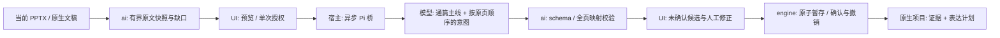

# #20：全稿归纳工程检查点

状态：历史全稿归纳工程检查点，不是当前目标产品。用户反馈已否定独立“提取—归纳—暂存/确认”操作台；产品主流程改为统一聊天与页面工作区，见 [迁移计划](ai-unified-workspace-plan.md) 与 [最新 RFC](rfcs/ai-assistant.md)。底层能力可选择性复用，不能继续以本页操作路径作为 #20 的验收目标。

以下保留原工程记录：已实现桌面全稿归纳路径；未获真实用户文稿的模型质量与人工验收。本轮未发送个人文稿，未运行认证/付费模型 smoke；离线回归不是归纳质量证明。旧 #15 B 单页改写未在该检查点实现。

## 产品路径

打开自己的 PPTX / `.deckcraft` → 右上 **AI** → 加载 Pi 模型 → 明确选模型 → 核对原文证据/读取缺口与端点 → 勾选发送授权 → **归纳全稿主线与逐页意图** → 修正主线、页作用/简短意图 → 暂存或确认 → 另存 `.deckcraft`。

旧的上下两块连接先导/离线摘录区域已替换为单一流程。原文证据和连接细节默认折叠，意图区不是原段落副本。候选可点击定位原页。

## 契约与边界

- `model/summary.rs`：版本 1 `SummaryReview { version, summary:{mainline,pages:[pageId,role,intent,unknown]}, evidence }`。`summaryDraft` 与 `confirmedSummary` 独立持久化。旧 `Outline` / `ContextDraft` 字段存在不代表新版确认；界面明确要求重新归纳。
- `ai/synthesis.rs`：只读提取，发送所有页的有序 `sources`、稳定 ID、覆盖诊断和补充素材。来源含组合路径/段位置；不把摘录标题/要点冒充语义大纲。JSON 序列化有预算，任何 `Limit` 提取诊断都阻止发送。
- `ai/request.rs` 与桥：新 `summarize` 请求 / `summary` 终态，独立于旧 smoke 的 `generate` / `result`；仍使用 #15 A 的无工具模型调用和认证/传输限制。模型无法写回证据、命令、文稿目标或版本。返回必须精确覆盖原页 ID 与顺序。
- `ui-egui/ai_pilot.rs`：每个运行期文稿独立工作副本，单宿主单请求。编辑补充说明只影响下一轮发送，旧候选仍绑定不可变证据；需重新归纳后才能随该候选保存。发送授权不等于确认大纲。切标签不串稿，关闭来源文稿取消并清理私有副本；迟到响应被丢弃。
- `engine ai.setSummary`：明确暂存或确认；确认同时安装简短兼容 Outline、原文依据/素材和新版表达计划，一步撤销/重做，不增删、重排或修改幻灯片。拒绝新增/删除/重排后过期的全稿映射。旧 `ai.accept` 不再用页面全文覆盖已有新版表达计划，完整改页契约仍属 #15 B。
- `.deckcraft` 保存/恢复全部数据；PPTX 不保证这些字段。带 AI 元数据的非原生保存作为导出处理，返回 `nativeSaveRequired:true`，保留原生保存基线、原路径与未保存/恢复状态，UI 提示原生另存。

## 限制（不隐藏）

当前最多 64 页；复用摘录器的每页 4096 对象 / 16 层组合 / 32 正文段 / 64 来源等上限。遇到任意提取裁切，不发送“前几页/前几段”却声称全稿理解。总 IPC 与实际模型请求 512 KiB、输出及上游解码 1 MiB、120 秒，无自动重试。超预算阻止本轮，尚未实现分段综合。

读取页内与组合文字；不读取图片、图表、表格、隐藏对象、母版/布局、备注，不做 OCR。缺口显示并发送给模型；无来源的页面必须保留未知。全稿都没有可读原文时阻止推断。可为有原文的文稿补充用途、受众及未读内容说明，作为独立用户数据，不冒充原文。手改页面不自动覆盖原文快照或确认计划，需显式重新提取。

侧栏编辑仍只在内存中，只有“暂存”或“确认”才进入文稿历史/原生保存；重新提取丢弃未暂存工作副本，不清空已确认内容。SDK/Bun 仍为可选原生开发依赖，仅内置 openai-codex；Web 不提供本地模型桥。

## 本轮验证

- `cargo test -p deckcraft-ai -p deckcraft-engine -p deckcraft-ui-egui -p deckcraft-format --lib`：通过。包括真实 PPTX 字节导出/重新导入后全页原文进入请求、严格 schema/全页 ID 顺序、取消/迟到/失败/切标签/关闭、确认与一步撤销、原生草稿/确认恢复、PPTX 保存语义、单一侧栏可见操作链。模型由测试 Host 替身提供，无网络/认证。
- `bun test scripts/ai/pi-bridge/protocol.test.ts`：通过（7 tests），含全稿新契约、坏字段/控制字符/重复 ID、流截断与工具调用拒绝，以及旧传输回归。
- `cargo test -p deckcraft ai_host --bin deckcraft -- --ignored`：通过；Bun-only 离线子进程清理回归，不读取认证。
- `cargo xtask layers`、`cargo xtask wasm`：通过。
- `cargo fmt --check`、`git diff --check`、`cargo test`（workspace 默认套件）、`cargo test -p xtask`、`cargo clippy --all-targets -- -D warnings`：通过。默认忽略的媒体/性能测试未运行；Bun 子进程忽略测试已按上方命令单独运行。
- 桌面样本界面已实际启动并截图复核；发现重复“全稿归纳”标题后删去并重新截图 `/tmp/deckcraft-summary-ui-final.png`。仅检查无请求初始界面与内置 Northern Lights 样本，没有把该截图当作模型结果或归纳质量证明。

## 真实验收待办

人在 App 中发送明确授权的真实多页文稿，核对主线是否体现推进关系、页意图是否为提炼而非复制、图片等缺口是否诚实；修正、确认、取消、撤销/重做、保存重开。未完成前不关闭 #20，不用 Fake 或自动测试冒充用户认可。

另有显式公共素材 smoke：`bun --no-env-file --no-install scripts/ai/pi-bridge/smoke.ts --live MODEL_ID --whole-deck`。该命令发送固定虚构四页 JSON，仅验结构、映射和未知页，使用 Pi 登录及模型额度；不是导入真实文稿或人工质量验收。

关键决策：独立版本化“表达计划 + 原文依据”，避免全文摘录冒充大纲或兼容字段被误认已确认；先采用超限整轮拒绝，避免有限截取伪称通篇理解。
