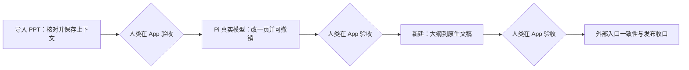
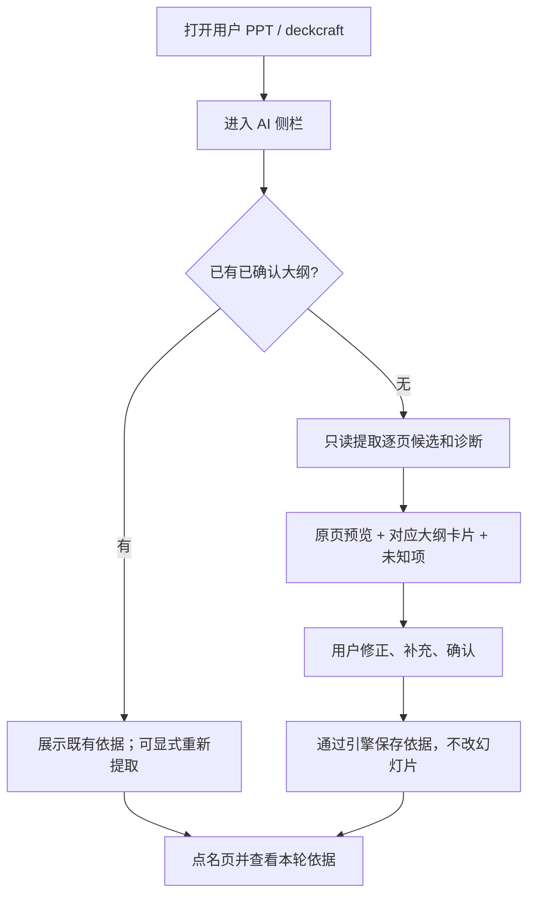
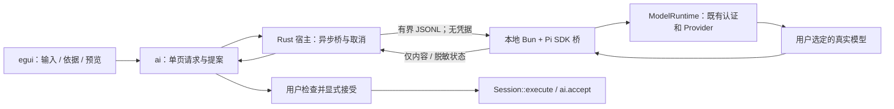
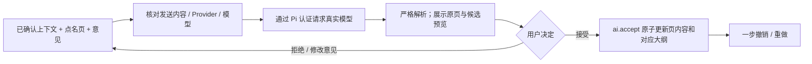

# 内置 AI 助手：产品小步交付与 Pi 认证先导

> 检查点说明：原 P1 离线大纲确认流程待修订。接下来先复用 #15 接通最小真实 AI 入口，再结合全稿生成候选大纲；旧 #13 人工验收不再是模型入口前置。当前只封存工程成果，不宣称产品验收通过。

状态：旧计划记录，待需求修订；真实模型与全稿归纳尚未实现。总追踪：[#10](https://github.com/hyperlook/deckcraft/issues/10)。

本版按用户决策替换原 A1–A9 技术分层交付顺序：**先让人在 App 里核对导入上下文，再用现有 Pi 认证真实改一页；不等整套基础设施完成。** 本轮仅修改计划和 issue，没有实现或验证真实模型调用。代码核对基线仍为 `0661aa2`，实现时读取最新代码。

本方案扩展 [产品约定](ai-assistant.md)，保留单页显式接受、原子写入和撤销语义。旧 #1/#3/#7/#9 的撤回方案不恢复。

## 1. 交付原则：模块分层，不按层交付

原计划把契约、上下文、状态机、Provider、输入面板、整合分成前后置任务。用户到 A6/A7 才能验证产品，工程测试通过也不能证明方向正确。

改为每阶段交付一个可操作的小场景，包含该场景所需的最小 UI、应用服务、引擎契约及测试。不得把“先冻结全部未来接口”重新设为第一关。

- 每阶段有可运行版本、简短操作路径、测试证据、截图或录屏和已知限制；截图不能代替用户试用。
- 实现完成后状态是“等待产品验收”。代码合并、自动测试、代理自评都不等于人类确认。
- 未通过验收，不推进依赖该产品假设的功能。缺反馈时保留检查点，不自行判定通过。
- Pi 连接的独立技术预检可立即进行，不必等 P1；但不能用连接成功代替 P1/P2 产品验收。共享工作区保持单写者，不因顺序调整自动启动并行代理。
- Fake Provider 用于开发、CI 和异常回归，不再设一个用户必须等待的假模型阶段。无真实调用证据时，明确写“未验证”。
- 失败或反馈不符时只重做当前步骤；保留已确认上下文，不要求从导入重新开始。

## 2. 第一项产品能力：导入 PPT 后建立可核对的上下文

人类引入的 PPTX 通常没有 DeckCraft 大纲。**现有页面不是已经商量好的大纲，提取到文本也不等于理解了整份文稿。** 这不是后台初始化细节，而是首次使用 AI 的产品入口。

### 上下文界面必须回答的问题

| 用户需要核对 | 首版呈现与边界 |
|---|---|
| 系统认为每页在讲什么 | 逐页标题/要点候选，与真实页面预览并排；点击卡片定位原页 |
| 内容是否来自原稿 | 区分页面摘录、人工补充、模型归纳；保留页与来源定位 |
| 哪些地方没理解 | 图片、图表、组合、空页等给明确诊断，不用空要点伪装解析成功 |
| 整份文稿的用途和受众 | 允许用户补充为上下文素材；未知就标未知，不强制填写无关表单 |
| 本轮到底使用什么 | 展示目标页、采用的大纲/素材和上下文覆盖缺口 |
| 系统会改什么 | 读取上下文范围不等于写回范围；单页修改只覆盖明确的标题/正文 |

- P1 不依赖网络：先真实导入、只读提取和人工整理。无需模型先“读懂全稿”才能出现界面。
- 优先复用现有 `Outline`、`Material`、`ai.setOutline`、`ai.setMaterials`。现有 `Outline` 没有候选来源/确认状态；必要的候选、诊断及未完成草稿状态由本阶段最小设计补齐，不能声称已有。
- 候选允许统一确认、重点修正异常页，不强迫用户逐字重写所有页面。支持暂存未完成草稿；草稿与已确认依据分离，恢复时仍标未确认。
- 只有显式确认的内容成为事实依据。目标页缺必要依据时先补齐；其他页缺失时展示覆盖范围并让用户确认有限上下文，不能假称完整理解了全稿。
- 未确认候选、未知标记与诊断不混入事实。限制/覆盖信息可作为独立控制元数据送入请求，不能编成内容结论。
- 没有可读文本时请用户补充说明；不默认做 OCR、图片理解、图表解读或外部文件解析。模型后续归纳也只能产出待确认候选，不新增无出处的数字和断言。
- 提取、取消、编辑草稿均不修改页面或已确认依据；确认通过命令保存，可撤销。确认的大纲/素材随 `.deckcraft` 保存恢复。
- 手改页面不会自动反写大纲。重新提取须显式触发，对照将覆盖的依据并确认，不能每次请求都从画布抓字覆盖。
- PPTX 不保证保留 AI 元数据，重新导入时仍走本流程。页对应关系绑定 `docUid + pageId`，不绑定页码或当前活动标签。

**P1 人工验收**：用户打开自己的 PPT，在同一界面发现并修正漏页/错配/未知项，确认保存，重新打开核对；取消和撤销也能实际操作。第一轮反馈发生在此处，而不是等 Provider 或新建流程完成。

## 3. 真实模型前移：复用当前 Pi 认证

### 已核实的接入依据，不是已完成的功能

本机 Pi SDK 文档与声明提供 `ModelRuntime.create()`、`getAvailable()`、`getModel()`、`streamSimple()`。SDK 的认证示例通过 `ModelRuntime` 使用保存的认证，可指定 `authPath` / `modelsPath`；Provider 层处理 API key 与 OAuth 的差异。

依据：Pi 的 `docs/sdk.md`、`docs/providers.md`、`docs/configuration.md`、`docs/security.md`、`examples/sdk/09-api-keys-and-oauth.ts` 及 `dist/core/model-runtime.d.ts`。实现时核对安装版本，不使用旧版 `AuthStorage` 示例臆造当前接口。本轮未读取或复制认证内容，也未调用真实服务。

### 首个适配器：受限本地桥接，不是完整 coding agent

- 优先使用 Pi 当前 agent directory 的认证，由 SDK 解析并管理刷新；尊重 `PI_CODING_AGENT_DIR` 或用户显式指定位置，不硬编码开发者绝对路径。
- **复用认证不等于复制 token**：Rust/UI 不解析 `auth.json`，不把 OAuth token 当普通 OpenAI API key，不迁移认证到 DeckCraft 设置；SDK 刷新可能更新其原认证存储，沿用 SDK 并发/刷新机制，不自行重写。
- **复用认证也不等于自动继承当前对话**：显式传入或在界面选择 `provider/model`。可用已知当前 Pi 选择预填并展示，不能把认证文件当作会话模型配置；不发送本次编码对话、仓库上下文和聊天历史。
- 首期只需要“使用 Pi 已有认证”、模型选择、状态与重试入口。认证缺失/过期无法刷新时提示到 Pi `/login`，不先造登录、密钥库和完整 Provider 设置页。
- 使用 SDK 模型调用层，不创建默认 `AgentSession`，不启动完整 `pi --print`/RPC agent；不加载工具、MCP、skills、项目指令或自动发现的扩展。模型无读文件、跑命令、执行代码或自动改稿权限。
- 内置 Provider 与用户已配置模型优先。依赖专用扩展的 Provider 若不能直接复用，明确报告；经用户确认后仅加载已审查的认证/Provider 适配能力，不能退回加载全部扩展。
- 用户选定的 Pi 配置属于受信任本地配置；其中凭据解析命令由 SDK 管理，不接受文稿、模型或远端参数指定认证路径、命令、模块路径或新端点。
- 启动固定桥脚本，输入走 stdin，不经 shell 拼接，不把正文或凭据放命令行。stdout 只用于有界协议，stderr 脱敏；桥不能收到任意 engine 命令。
- 先用非敏感固定素材完成一次真实连接/结构化输出 smoke，记录 SDK 版本、provider/model、成功或脱敏错误。可立即开展这项预检；不要等通用 Provider 框架或全部 UI 完成。
- 随后必须在 App 中用已确认上下文真实改一页。连接 smoke、假数据预览均不能替代此项验收。

### 先导边界

这是**原生桌面的可选本地开发先导**，允许在宿主外增加 Bun/Pi SDK 桥接依赖；Rust 核心与文稿写入仍在原架构内。不宣称新增功能已是全 Rust 独立分发，也不把 Bun/Pi 变为手动编辑的必需依赖。依赖缺失立即报告，不自动安装、不偷偷切换协议。

不预先建设通用 `ai-provider` crate、全新 OAuth 客户端或完整 OpenAI-compatible HTTP 层。需要独立分发、其他认证或 Web 网络能力时，再以可替换适配器扩展；Web 首期明确显示 Pi 本地适配器不可用，正常编辑与 WASM 编译不受影响。

## 4. 第二项产品能力：真实改一页，用户接受后才写入

- 复用现有 `Round`、`PageProposal`、`ai.accept`；模型只返回标题/要点等受限内容，不决定写哪个文档。可信请求上下文回填目标。
- 目标绑定 `docUid + pageId`。切标签不换目标，重排不改变身份；删页、关文稿阻止提交，重新打开同一路径是新的文档身份。
- 修改只覆盖标题/正文，保留图片、表格、组合、页脚和版式。现有 fallback 可能只找到首个普通文本框，必须明确替换范围；不支持时返回 `NoStory`。
- 接受前分别显示“本轮使用的依据”和“现在将被覆盖的文字”，并给真实渲染预览；不能只显示 JSON 或让人审代码。预览复用引擎候选/渲染语义，不提前写入 live Session。
- 等待时手改页面不使请求失效；不做冲突合并。拖动未松开时拒绝写入，不自动等鼠标松开后提交。
- 拒绝、网络失败和重试不清空已确认上下文；编辑意见只重跑当前请求。用户更换本轮依据后需新请求，旧结果仍标旧依据，不冒充新输入的预览。
- 相同内容再次接受不增加历史；撤销后允许重新接受同一单页提案，不永久消费 proposal token。

**P2 人工验收**：人在 App 中真实请求、核对上下文与改写质量、接受/拒绝、撤销/重做。使用自己的选定文稿前，明确发送内容及服务商；无密钥或网络阻塞时保留“未验证”，不用 Fake 替代。

## 5. 后续产品能力：新建与外部入口

### P3：新建文稿

主题/受众/素材 → 模型生成候选大纲 → 用户编辑确认 → 原生预览 → 显式创建新标签页 → 保存/导出。

- 一次生成整份结构化大纲，不启动逐页 agent 或并发任务池。大纲未确认不自动创建文稿。
- 新建使用 `draftId`；未创建的页面不伪造 `docUid` / `SlideId`。到本阶段才增加 `DeckProposal` 和受限 `ai.createDeck` 契约。
- 只使用内置主题和标题/正文版式；不接受任意元素树、坐标、代码、路径或 XML。模型生成内容，引擎决定布局。
- 预览与提交共享确定性候选构建逻辑；更改大纲使旧预览失效，重建受影响结果即可，不清空其他确认内容。
- 完整校验并在隔离值中构建后才安装；失败不留空标签，不修改当前及其他文稿。
- 生成内容是新文稿内的一条历史；撤销回到该标签页空白状态，不隐式关闭标签，重做恢复页面/大纲/素材。
- 同一次创建动作的重放不能重复开标签；用户明确再次创建需新动作身份。
- 新建至少 1 页，最多沿用 64 页；要点允许 0 条，上限 32。协议上限不是视觉密度标准；严重裁切阻止创建或要求缩短，不静默丢字。
- 内容须为原生可编辑文本/形状，不以整页截图作为成片。全页视觉重设计、自动图表/搜图、模板市场另立任务。

### P4：CLI / MCP / control

复用已经在桌面验证的应用服务，补齐 `assistant.start/status/cancel/accept` 等生命周期路由；现有通用 execute 对 `ai.*` 的支持保留。不重复写 runtime/Provider，不让程序调用触发模态对话。

新建接受使用稳定动作身份处理断线重放；单页撤销后新 accept 仍允许。无 UI 时也须显式接受，不根据模型响应自动写稿或保存文件。此阶段不阻塞首次桌面产品验收。

## 6. 深模块边界与最小契约

| 边界 | 负责 | 不负责 |
|---|---|---|
| model | 已确认大纲、素材及必要的兼容持久化 | 聊天历史、凭据、HTTP 响应 |
| engine | 唯一写入边界、受限命令、候选构建、原子提交、历史 | 模型网络调用 |
| ai | 候选上下文、不可变请求快照、状态、解析与提案 | 持有可变 Session、后台写锁 |
| Rust 宿主 | 组合服务、桥进程生命周期、I/O、主线程串行提交 | 自己实现 OAuth、从模型接收任意命令 |
| Pi 桥 | 认证/Provider 复用、受限模型调用、有界内容事件 | 工具执行、修改文稿、保存对话 |
| ui-egui | 原页/大纲核对、输入、状态、预览、明确接受 | prompt/HTTP、直接修改 Presentation |

- `xtask` 当前把 ai/ui-egui/mcp 都放在 L6，不能直接无视同层依赖门禁。随实际依赖按需增加精确 `ai → ui-egui` / `ai → mcp` 的 `INTRA_LAYER_ORDER`（前者可被后者依赖），加正反例测试；不开放任意 L6 横向边。
- 不为尚未采用的 `ai-provider` 提前改层级。进程启动留在原生宿主；core L0–L5 与 ai 保持 WASM 可编译。
- P1 只定义上下文准备/确认所需接口；P2 加单页请求与桥协议；P3 加新建；P4 再固定外部路由。每阶段把实际使用的契约与测试一同交付。

### 从首个真实请求起必须具备的边界

- 每宿主最多一个正在请求的任务；不可变输入快照与明确 `requestId`。不排复杂队列，不无提示覆盖请求。
- 至少区分请求中、可预览、失败、取消、已接受；取消、超时和旧请求的迟到响应不能重新变成可接受提案。
- 后台只发布提案/状态，显式接受才由宿主串行调用 engine。失败、无效 JSON、目标丢失、手势进行中均不能误写。
- 总输入默认 512 KiB、总输出默认 1 MiB、期限 120 秒、事件队列最多 64 项，作为 P2 的初始有界配置。测试边界值，若调整需记录原因。
- 输入与 JSONL 单帧在缓冲前限制；输出累计计入流式文本、推理及其他事件，不仅限制最终 JSON。审查 SDK 内部缓冲/传输限制；仅限制桥 stdout 不代表上游有界。若当前 SDK 无法满足，报告缺口并补受限传输/进程资源保护后再宣称通过。
- 取消向 SDK 传播 AbortSignal；桥异常、卡死、退出和应用关闭均清理进程/管道并丢弃迟到事件。UI 不阻塞网络或等待进程退出。
- 默认不自动重试；验证底层 SDK/Provider 的重试设置，避免隐性重复费用。用户可保留上下文后显式重试。
- 严格 schema/字段白名单，整数/有限尺寸/集合容量校验；流式进度不是可提交提案。禁止执行模型 tool call；返回工具调用视为无效响应。
- 错误至少包括认证不可用、限流、网络失败、超时、取消、桥不可用/退出、结构无效、超限、文档关闭、页删除、无可替换文本和手势进行中。仅输出可操作的脱敏提示。

## 7. 数据与安全

- 事实来自已确认大纲和已准备素材；用户意见不是新增事实来源。系统提示不是真实性保证，确认界面仍需人工检查数字/断言。
- 首次发送前显示服务商/模型、选定端点（如有）和实际发送内容；不默认上传整份文件、文件路径、图片二进制或聊天历史。
- 素材是数据，不是指令。入口为粘贴文字、用户选定 UTF-8 txt/md、手填图片说明；文件选择/读取由宿主完成。PDF/Office/OCR 与自动 URL 抓取不在首期。
- 凭据不进入 Presentation、UI 持久化、请求快照、IPC、命令行、Git、日志、截图或模型上下文。状态只返回“可用/需登录”等脱敏信息。
- Pi 认证只用于用户选定且匹配的 Provider；不转发到任意 OpenAI-compatible 地址，不做跨源带凭据重定向。
- 用户可预览/移除素材；保存到原生文稿前显示隐私提示。测试默认使用固定非敏感夹具，不让 CI 自动使用个人 Pi 认证或付费额度。
- 不加生产 panic/unwrap/unsafe；失败保留文稿，崩溃修复附回归。

## 8. Issue 重排与交接

保留 #10 为唯一总追踪，复用已有编号，取消“纯基础设施 PR 必须先全部合并”的串行链。

| 阶段 | Issue | 交付与前置条件 |
|---|---|---|
| P1 | [#13](https://github.com/hyperlook/deckcraft/issues/13) | 第一项：导入 PPT、逐页核对/修正上下文、确认/暂存/恢复；无旧 A1 前置 |
| P2 | [#15](https://github.com/hyperlook/deckcraft/issues/15) | Pi 认证真实改一页，含最小 runtime、侧栏预览、接受/撤销；独立连接预检可立即开始，产品整合需 P1 合并且人工验收 |
| P3 | [#12](https://github.com/hyperlook/deckcraft/issues/12) | 新建大纲、确认、原生预览、创建/保存/导出；P2 合并且人工验收 |
| P4 | [#18](https://github.com/hyperlook/deckcraft/issues/18) | 已验证双流程的 CLI/MCP/control 一致性；P3 合并且人工验收 |
| 持续 + 收口 | [#19](https://github.com/hyperlook/deckcraft/issues/19) | 每阶段收集证据；末尾做发布门禁，不把回归全部留到最后 |

旧任务按 **not planned / superseded** 关闭，不表示实现完成，也不能把 GitHub 子任务关闭比例当作产品完成度：

- #11 纯契约：并入 P1–P4，各阶段只定义本阶段所需接口及层级测试。
- #14 纯状态机：单页部分并入 P2，新建部分并入 P3，Fake 为随行测试。
- #16 纯输入面板：导入上下文面板并入 P1，模型/意见/请求面板并入 P2，新建面板并入 P3。
- #17 后期双流程整合：改页预览/接受/撤销并入 P2，新建整合并入 P3。

每项可包含小步工程提交，但第一个可交付结果必须可在产品中操作。跨模块改动维持单写者，不让文件归属人为阻断产品场景。

交接必须包含：基线/PR、改动文件、实际接口、运行命令与真实结果、产品操作路径、截图/录屏、真实调用或未验证原因、人工验收结论、剩余问题和下一步。未获人工确认应标“等待产品验收”，不能直接关闭产品阶段。

**下一对话启动语**：请实现 #13，第一项结果必须能在现有 App 里打开用户 PPT、对照原页核对/修正大纲并确认保存。不要先实现旧 #11。#15 的 Pi 连接预检无需等待完整 UI，但不作为 #13 的前置条件；产品交付后停在人工验收点。

## 9. 总验收

- [ ] P1 用户在 App 中核对真实导入文稿；不靠代码 review；草稿/确认依据区分，取消/撤销/保存恢复可操作。
- [ ] 缺失上下文、图片页和复杂页明确标未知；未确认信息不冒充事实；页面身份与来源可追溯。
- [ ] P2 通过已有 Pi 认证完成一次非敏感真实 smoke，并在 App 中真实改一页、预览、拒绝/接受、Undo/Redo。
- [ ] 认证复用不复制 token、不加载完整 agent 工具；没有 Pi 时仍正常编辑；无真实调用时明确未验证。
- [ ] 非文本对象与非目标页不变；等待时手改、切标签、重排、删页、关文稿、拖动均遵守既有语义。
- [ ] 取消/超时/坏 JSON/限流/超限/进程退出/迟到响应不误写；拒绝或重试保留已确认上下文。
- [ ] P3 新建原生可编辑页面，预览和提交一致；大纲修改需重建预览；重复传输不多开标签。
- [ ] 中英文/长文本有渲染证据，无严重裁切、丢字或遗留旧要点；导出再导入仍可编辑。
- [ ] P4 无 UI 调用不弹窗、生成与接受分离；行为与桌面一致。
- [ ] 各阶段具有人类产品验收记录；没有记录就保留等待状态。
- [ ] `cargo fmt --check`、`cargo clippy --all-targets`、`cargo test`、`cargo xtask layers`、`cargo xtask wasm`；桥接增加 Bun 离线测试。缺工具即报告，不安装、不虚称通过。

## 10. 关键决策

1. **模块边界保持，交付单位改为用户可操作的场景**：先验证上下文和改页体验，减少后期整合才发现产品误解的返工。
2. **先复用 Pi 认证与 Provider，后考虑独立适配器**：快速验证真实模型效果，同时把模型调用与文稿写入分开；本地桥接的分发与 WASM 限制明确保留，不掩饰为已完成的通用方案。
