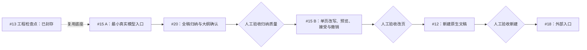
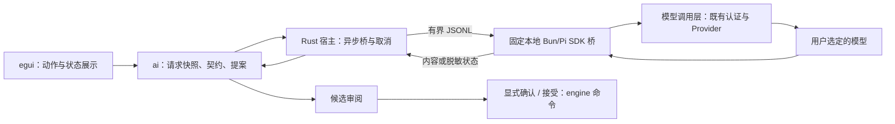
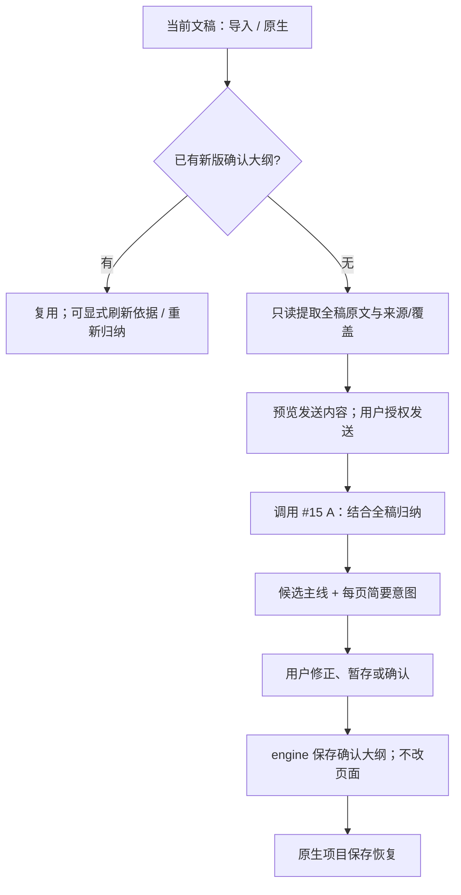

# 内置 AI 助手：先接通模型，再归纳全稿

状态：产品修订后的实施计划，不是完整完成报告。#15 A 在 `feat/ai-minimal-entry` 已形成真实连接与桌面候选检查点，等待人工验收，见 [A 检查点](../ai-a-review.md)。#20 / #15 B 仍待实施。总追踪：[#10](https://github.com/hyperlook/deckcraft/issues/10)。产品约定见 [ai-assistant.md](ai-assistant.md)。

工程检查点：`checkpoint/ai-context-extraction`，代码提交 `7ae7951`，基于 `main@0661aa2`。只读提取、来源定位、诊断、素材入口、命令写入和原生保存已封存，未合入 main。该封存基线未实现真实模型、全稿归纳和新版大纲语义；后续 A 仅接通模型入口，不代表全稿归纳已完成。产品反馈与实际封存验证见 [ai-p1-review.md](../ai-p1-review.md)。

## 1. 为什么修改旧计划

旧 #13 要求“不依赖真实模型”却验收“大纲上下文”。实现把原段落直接复制为标题/要点，再由用户确认进入 Outline。它没有结合全稿提炼每页意图，实际上把整理大纲交给用户。

提取文字是合理工程步骤，不是大纲生成产品。现有 `ai.accept` 又把完整页面正文回填 Outline，进一步混用了表达计划与最终文案。新版分清三种对象：

| 对象 | 含义 | 责任 |
|---|---|---|
| 原文依据与素材 | 原稿实际写了什么、来源、读取覆盖与缺口 | 读取快照和数字/断言依据；不保证现实真实性 |
| 大纲 | 全稿主线、每页作用与简要表达意图 | 模型归纳，用户确认表达计划 |
| 页面文案与提案 | 每页最终怎么写 | 用户预览接受后，engine 原子写入 |

已有 PPT 能反向归纳出大纲，但不能把原文副本叫作大纲。确认是状态变更，不是语义提炼。

## 2. 顺序：最小模型入口 → 全稿归纳 → 改页 → 新建

- #15 是同一任务内的两个交付点，不另建重复模型入口：A 可独立开发，B 复用 A 并依赖 #20 的大纲与依据契约。
- #20 只依赖 #15 A 可用，不等待 #15 整体关闭；#15 B 再依赖 #20，避免循环等待。
- 旧 #13 合并或人工“大纲确认”不再是 #15 A 的前置。检查点代码选择性复用，不能通过合并来认可旧产品假设。
- 每阶段交付可运行的产品小场景，不先建全套基础设施。Fake 仅用于开发/回归，不作为必须验收的产品阶段。
- 只有真实模型与用户反馈能验证大纲质量。自动测试、代理自评和截图不等于人类确认。
- 共享工作区保持单写者；这些任务不授权自动并行代理。本次仅封存和立项，不开始模型开发或付费调用。

## 3. #15 A：最小真实 AI 入口

### 能力与依赖

最小界面只需：使用 Pi 已有认证、显式模型选择、发送范围预览、请求/取消、结果展示和可操作错误。先用非敏感固定素材完成真实连接与受限结构化输出 smoke，记录 SDK 版本、provider/model 和校验结果，不记录凭据。

这是可选原生桌面先导，暂需宿主外 Bun/Pi SDK，不冒称全 Rust 独立分发。没有 Pi 仍能正常编辑；Web 明确该本地适配器不可用，core/ai/UI 保持 WASM 可编译。

实施时重新读取当前 Pi 文档和类型声明。历史计划记录了 `ModelRuntime.create/getAvailable/getModel/streamSimple`，不能照搬旧 `AuthStorage` 示例或把历史核对当本次验证。参考 Pi 的 `docs/sdk.md`、`docs/providers.md`、`docs/configuration.md`、`docs/security.md`、`examples/sdk/09-api-keys-and-oauth.ts` 与 `dist/core/model-runtime.d.ts`；依实际安装版本修正。

### 模块调用链

- SDK 解析并刷新 Pi 原认证，尊重 `PI_CODING_AGENT_DIR` 或受信任用户指定位置；Rust/UI 不解析 `auth.json`、复制 token、迁移凭据或把 OAuth 当普通 API key。
- SDK 刷新可更新原认证存储，使用其并发机制，不自行重写。认证只用于匹配 Provider，不转发到任意兼容端点或跨源重定向。
- 模型显式选定，可预填已知选择并展示；认证配置不等于 coding 会话模型配置，不发送会话历史、仓库或项目指令。
- 不创建默认 AgentSession，不启动完整 `pi --print`/RPC agent，不加载工具、MCP、skills、项目指令或自动发现扩展。模型工具调用响应视为无效。
- 专用扩展 Provider 无法直接复用时报告；用户确认后仅接入已审查的认证/Provider 能力，不加载整个扩展集合。
- 认证路径、凭据命令、模块和端点只能来自受信任本地配置，文稿/模型/远端参数不能控制。
- 固定桥脚本，内容经 stdin，不经 shell 拼接，不把正文/凭据放命令行。stdout 专用于有界协议，stderr 脱敏，不接受任意 engine 命令。
- 无认证或刷新失败时提示 Pi 登录；不先造 OAuth、通用 HTTP Provider 或完整设置页。依赖缺失立即报告，不安装、不偷偷换协议。

## 4. #20：全稿原文依据 → 简要大纲 → 确认

- 读取快照与归纳候选分开。大纲归纳不依赖已确认大纲；`Round::from_confirmed` 是改页入口，不是归纳入口。
- 模型输入包含页顺序、全稿可读文字和来源/缺口，而非只送标题。默认归纳现有各页，不重排、增删或重新分配内容。
- 全稿超过输入预算时显式阻止或有界分段后综合。当前提取最多 64 页等限制必须披露，不能静默裁切却声称全稿理解。
- 未读图片/图表/表格/备注等标未知，不编造。有限上下文可供用户知情使用，不能要求逐字手工重写整稿。
- 原文放证据区；候选大纲显示简要全稿主线、各页角色与意图。人工补充、原文和模型推断有明确来源区分。
- 授权上传原文与确认归纳结果是两个动作。请求、取消、失败、候选编辑不修改页面或确认状态；草稿恢复仍未确认。
- 只补本场景实际契约；为旧检查点 Outline 的全文摘录语义提供明确版本/迁移，不把字段存在当成新版确认状态。
- 简要大纲不取代原文事实。后续改页必须能传递相关数字/条件/来源，不仅发送压缩大纲。

**验收**：人在 App 里用真实多页文稿核对主线与各页意图，修正确认、取消、撤销/重做、保存重开。结果是提炼而非复制，未知和预算缺口可见。实现后停在人类验收点。

## 5. 保存与文稿生命周期

| 场景 | 最小规则 |
|---|---|
| 导入 PPTX | 创建当前项目，原文提取作为依据，不要求先进入全局文稿库 |
| `.deckcraft` 保存 | 保存依据、确认大纲、素材、来源/覆盖、必要草稿和兼容版本 |
| 原生重开 | 复用确认大纲；草稿仍未确认 |
| PPTX 导出 / 普通保存 | 不保证 AI 元数据；不得伪装已安全保存，提供原生另存或未保存提示 |
| 单独重导入 PPTX | 默认新项目，不承诺自动关联缓存或找回大纲 |
| AI 新建 | #12 复用同一项目保存规则；未创建前使用 draftId |
| AutoRecover | 异常恢复，不等于正常项目库，不保证侧栏内存编辑落盘 |

当前检查点仅实现部分原生恢复，PPTX 普通保存策略仍待 #20 修正。先做项目文件，不预建全局缓存；未来外部文件关联缓存另定义稳定身份、源变化、清理与隐私，运行期 docUid 不能用作持久身份。

手改页面不静默反写大纲。依据显式刷新并记录版本/差异，用户决定是否重做归纳；重试不要求从导入重新开始。

## 6. #15 B：单页改写

输入：已确认大纲、相关原文依据/素材、稳定目标、用户意见。模型仅产出受限内容；可信宿主绑定 `docUid + pageId`，不让模型选择其他文稿。切标签/重排不换目标，删页/关文稿阻止提交，重开同一路径是新运行期身份。

- 原页与候选真实渲染预览可比较，分别展示请求依据和当前将覆盖文字；预览与接受共享确定性候选逻辑，不提前写 live Session。
- 接受只替换明确标题/正文，保留非文本对象、页脚与版式。不支持返回 NoStory，拖动未松开拒绝提交。
- 不将完整标题/正文全文回填大纲。意图不变则保留；意图变化则包含独立简要大纲变更并一同审阅，接受原子写入，一步撤销。
- 检查点 `ai.accept` 与旧 PageProposal 仍需适配该契约；复用接口不等于盲目沿用旧语义。
- 等待时手改不自动作废单页提案，不做冲突合并。改变本轮依据需新请求，旧结果不冒充新依据预览。
- 拒绝/失败/取消不清空确认内容。相同内容重放不增加历史；撤销后可再次接受同一提案。

**验收**：真实改一页、用户评价表达质量、接受/拒绝/撤销/重做；非目标页与非文本对象不变。无真实调用证据则标未验证，Fake 不替代。

## 7. #12 新建与 #18 外部入口

### 新建

主题/受众/素材 → 候选简要大纲 → 用户确认 → 页面文案与原生预览 → 显式创建新标签 → 原生项目保存 / PPTX 导出。

- 一次生成整稿大纲，不逐页 agent 并发。确认大纲之前不自动创建文稿；使用 draftId，不伪造 docUid/SlideId。
- 仅内置主题和标题/正文版式，不接受任意元素树、坐标、代码、路径或 XML；引擎决定布局。
- 页面文案与大纲分开，预览/提交共享确定性构建。修改大纲使旧预览失效，重建受影响结果。
- 完整校验并隔离构建，失败不留空标签、不改其他文稿；创建在新文稿形成一条历史，撤销回到该标签空白状态，不隐式关闭。
- 重放同一创建动作不能多开标签，显式再次创建需新动作身份。
- 沿用当前初始 1–64 页协议范围、每页 0–32 要点；上限不是视觉密度标准，严重裁切阻止创建或要求缩短，不静默丢字。
- 原生可编辑文字/形状，不用整页截图成稿。完整视觉重设计、模板市场、自动图表/搜图另立任务。

### 外部入口

复用桌面验收的应用服务，补 CLI/MCP/control 生命周期，不重复 runtime/Provider。程序调用不弹模态，生成与接受分离；无 UI 也须显式接受，不自动写稿或保存文件。稳定动作身份处理断线重放；此阶段不阻塞首次桌面验证。

## 8. 模块边界与从首次请求起的安全要求

| 边界 | 负责 | 不负责 |
|---|---|---|
| model | 依据、大纲、素材、必要草稿及兼容持久化 | 聊天历史、凭据、HTTP 响应 |
| engine | 唯一文稿写入边界、候选构建、原子命令、历史 | 网络模型请求 |
| ai | 快照、归纳/改页契约、请求状态、解析提案 | 持有可变 Session 或后台写锁 |
| Rust 宿主 | 桥进程、I/O、取消、主线程串行提交 | OAuth 或模型任意命令 |
| Pi 桥 | 既有认证/Provider 与受限模型调用 | 文件/命令工具、修改文稿 |
| ui-egui | 输入、发送范围、状态、原页/大纲/提案审阅 | prompt/HTTP 或直接写 Presentation |

层级以 xtask 当前表为准。检查点已精确开放 `ui-egui → ai` 同层边，继续保留正反例；不允许任意 L6 横向依赖，不提前建立通用 ai-provider crate。

- 单宿主最多一个活动请求，requestId 与不可变快照；至少区分请求中、候选、失败、取消、已接受。取消/超时/关闭/退出后迟到响应不得重新激活。
- 初始总输入 512 KiB、累计输出 1 MiB、期限 120 秒、队列 64 项；单帧与累计量均有界，输出计入推理和其他事件。调整须有测试/依据。
- 审查 SDK 上游传输/内部缓冲，stdout 限制不代表全链有界；不足时补受限传输/进程保护或报告阻塞。
- AbortSignal 传播取消，退出清理进程/管道，UI 不阻塞。默认不自动重试，核对底层 SDK/Provider 隐性重试与费用。
- schema/字段白名单、整数/有限值/集合容量验证；流式进度不是可提交提案，工具调用判无效。
- 错误覆盖认证、限流、坏 JSON、超限、取消、超时、网络、桥不可用/退出、目标丢失、NoStory 和手势进行中；脱敏且可操作。
- 凭据不进入文稿、UI 持久化、请求、IPC、命令行、Git、日志、截图。首次发送显示 provider/model/端点与实际发送范围。
- 素材只作数据；初期仅粘贴、选定 UTF-8 txt/md 和图片说明，不自动抓 URL/OCR/PDF/Office。素材保存前说明隐私，CI 不使用个人认证或付费额度。
- 生产代码无 panic/unwrap/unsafe，输入与分配有界，崩溃修复附回归，保持 WASM。

## 9. 跟踪、验证与下一步

| Issue | 当前定位 |
|---|---|
| #13 | 离线提取检查点与历史记录；保持 open，不冒称旧大纲验收完成 |
| #15 A | 已有真实连接/桌面入口检查点，等待人工验收；不依赖旧 #13 验收 |
| #20 | 全稿归纳、三个对象分离、确认与项目保存；依赖 #15 A 可用 |
| #15 B | 基于 #20 结果真实改一页；A/B 全部验收后再关闭 #15 |
| #12 | 新建大纲、页面文案、原生预览与项目保存；改页验收后推进 |
| #18 | CLI/MCP/control 一致性；桌面双流程验收后推进 |
| #19 | 每阶段证据与发布收口，不把所有回归留到最后 |

旧 #11/#14/#16/#17 是 superseded，不代表实现完成。交接包含分支/提交、实际接口、运行命令与结果、可运行操作路径、真实调用或未验证原因、用户反馈和限制。未获人类确认标等待验收，不自动关闭产品任务。

工程门禁：`cargo fmt --check`、`git diff --check`、`cargo test`、`cargo test -p xtask`、`cargo clippy --all-targets -- -D warnings`、`cargo xtask layers`、`cargo xtask wasm`；桥实施时补 Bun 离线测试。默认忽略的渲染测试和历史证据须区分，不能虚称本轮重跑。

**下一对话启动语**：先读 #10、#15、#20 与本页和产品约定，核对检查点分支。先实现 #15 A 的最小真实模型入口，再实施 #20 的全稿归纳与简要大纲确认；不要继续旧 #13 的摘录确认流程，不等 #15 整体关闭，不先造完整聊天助手或新建系统。首个真实 smoke 用非敏感素材，真实用户文稿发送须明确授权。

关键决策：原文事实与表达计划分离，避免提炼后丢失事实或全文冒充大纲；先交付最小真实调用，再验收全稿理解，不让旧离线产品假设阻塞验证。
