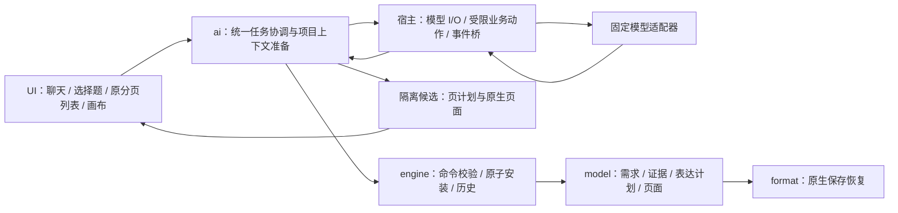
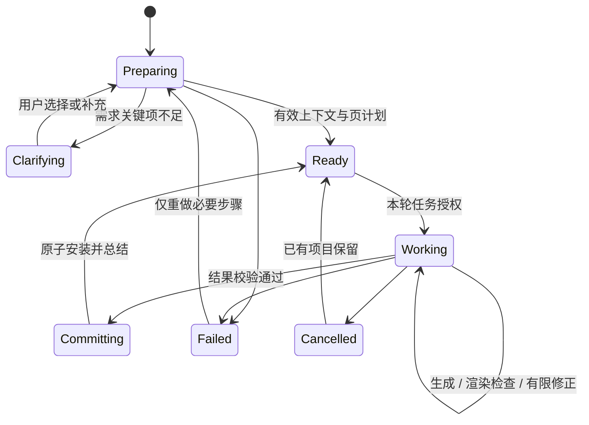
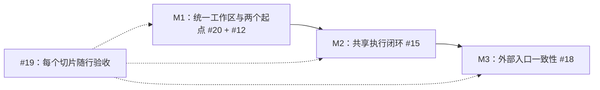

# AI 助手架构：统一工作区与共享执行流程

状态：目标架构与交付边界；M1 共同工作区至页计划已实现工程切片，真实模型/人工体验待验收，M2/M3 未实现。实际证据见 [M1 记录](../ai-m1-review.md)。产品依据：[统一 UX 约定](ai-assistant.md)。总追踪：[#10](https://github.com/hyperlook/deckcraft/issues/10)，工程取舍：[迁移计划](../ai-unified-workspace-plan.md)。

## 1. 深模块边界

| 模块 | 拥有的责任 | 禁止越界 |
|---|---|---|
| model | 需求、来源依据、表达计划、页状态/稳定映射及兼容版本 | 网络、凭据、UI 状态 |
| engine | 创建/调整页计划、候选构建、原子提交、取消保护与 Undo/Redo | 模型网络、业务聊天 |
| ai | 每个文稿的上下文准备与任务协调、澄清策略、受限动作/结果契约 | 可变 Session、后台写锁、平台 I/O |
| 原生宿主 | 固定桥、认证复用、异步 I/O、取消/退出、主线程执行授权动作 | 任意模型指令直通 engine/shell |
| ui-egui | 聊天输入、选择题、动作流、原分页列表中的候选投影 | prompt/网络、证据快照生命周期与任务编排 |

具体类型和命令随可运行切片设计，不先冻结全量未来接口。现有层级以 xtask 为准，任何依赖变化需正反例门禁并保持 WASM。

## 2. 用户不管理的状态

这是应用内部状态机，不是用户必须逐步点按钮的向导。
- 新建用澄清后的需求准备上下文；导入用提取的原文；原生重开用版本匹配的项目记录。
- 工作中的页计划/页面草稿投影在既有 thumbs/sorter/画布中，UI 只读投影并发命令。
- 页目标使用宿主分配的稳定 ID，不把页序号或模型输出当身份。
- 上下文记录版本/页映射与必要指纹；手改、删除、排序、Undo/Redo 后自动检查相关派生状态。
- 可以保留表达计划而更新事实依据；不得用新抓取的正文静默覆盖用户表达方向。
- 纯后台派生缓存不是一个新的用户撤销步骤；用户任务产生的需求/计划/页面变化按语义命令进入历史。

## 3. 当前成果保留与迁移

当前分支 `feat/ai-minimal-entry`，HEAD `fdf77da` 是已提交的 #15 A 连接先导；全稿归纳为未提交工作。均不代表统一体验已经完成。

保留工程能力：
- 固定 Pi 模型桥与认证隔离；输入/输出预算、超时、取消和迟到事件过滤。
- 原文来源、逐页 ID/顺序、覆盖缺口，表达计划与正文分离。
- engine 唯一写入边界、候选副本、原子撤销、原生持久化及 PPTX 元数据保护。
- 安全、取消、跨标签、关闭来源文稿、保存/恢复等回归测试。

迁移而非照搬：
- `Snapshot` 是导入文字理解的子步骤，不是全部文稿建模入口。
- `SummaryReview` 与 `summaryDraft/confirmedSummary` 是过渡存储；不能把 confirmed 当所有任务的产品就绪开关。
- `Round::from_confirmed` 仅靠 Outline/materials 的输入不足，需采用项目需求、原文依据、表达计划及目标页当前状态。
- 现有无工具的结构化桥可继续用于受限内容调用，但要增加共享协调层及动作/总结事件；不直接加载完整 coding AgentSession。
- `ai.setSummary` 可保留兼容/内部命令，但从正常 UI 移除逐轮暂存/确认流程。
- UI 中每文稿的工作副本/快照编排迁至 ai/宿主服务；UI 保留文字输入和展示状态。

## 4. 按共同体验交付，不按新建/修改拆产品

### M1：统一工作区与两个起点（#20 + #12）

先交付能运行的共同骨架，而不是纯架构 PR：
- 一个聊天入口、自动模型加载、少量选择题组件与可折叠动作流。
- 原生上下文复用、新导入后台理解、空文件需求澄清均接入相同协调服务。
- 页计划和已有页概括进入原 thumbs/sorter，允许直接扫看/调整。
- 稳定页槽位/计划态与原生恢复有最小命令和测试；后台状态不要求用户手动刷新。
- 验收两种起点确实汇合；本切片只声明到达共同页计划状态，不能声称新建成稿完成。

#12 只负责需求澄清起点并接入 #20；不等改页验收后再实现，不另建大纲生成器/创建标签流程。两个任务共同交付 M1，避免相互以“对方 issue 全部关闭”为前置。

### M2：同一执行器完成新建与修改（#15）

- 共享协调层将计划页展开成原生页面，并能修改现有目标页。
- 模型内容 → 候选构建 → 真实渲染/溢出检查 → 有限修正 → 原子写入。
- 原位草稿/进度、动作事件和最终总结来自同一任务，不能只返回标题/要点卡片便宣布完成。
- 一次用户任务一条历史；新建使用当前空项目，不自动多开标签。
- 一次迭代同时展示空文件成稿与导入后改页，不再分成 A/B 后另接新建。

### M3：外部入口（#18）

桌面共享流程验证后，为 CLI/MCP/control 增加同一 start/reply/status/cancel 和任务变更授权语义。澄清选择有机器可读结构，headless 不弹窗；共享服务，不复制 runtime。

### #19：随行验证

每个切片都区分工程测试、真实模型调用与人类反馈。无法发送真实文稿时标未验证，不自动消费个人额度。待验收不阻止不依赖该产品假设的技术工作，但不以旧独立归纳验收为新体验前置。

## 5. 工程门禁与非目标

- 凭据只在受信任模型适配层；文稿/模型不能控制脚本、模块、认证路径或端点。
- 只允许受限业务动作，不允许任意 shell、文件、URL 或 engine 命令执行。
- 默认单宿主一个活动模型请求；协调层不持有 Session 写锁，主线程串行命令提交。
- 沿用当前 512 KiB 输入 / 1 MiB 输出 / 120 秒的检查点预算；有界分段策略另按实际请求设计，任何覆盖裁切不能伪称全稿理解。
- 初始文字读取限制保留并披露，不将“后台建模”宣传成已支持 OCR/图片理解。
- 取消/超时/关闭清理任务与投影；迟到响应不得复活。目标变化不得静默覆盖新手改。
- 首版不做逐页并发 agent、通用 Provider/OAuth、复杂冲突合并、全局项目库、任意视觉重设计。
- `cargo fmt --check`、`cargo clippy --all-targets -- -D warnings`、`cargo test`、`cargo xtask layers`、`cargo xtask wasm` 随功能改动验证；模型桥有 Bun 离线回归。

## 6. Issue 迁移与下一轮

| Issue | 新职责 |
|---|---|
| #10 | 统一产品追踪，替代旧串行路线 |
| #20 | 共同工作区、后台上下文、页计划原位展示（M1 主线） |
| #12 | 空文件的选择题需求澄清，接入共同工作区（M1） |
| #15 | 共享 Agent 执行，计划页展开与已有页修改（M2） |
| #18 | 共享工作流的外部入口（M3） |
| #19 | 共同体验与发布证据，贯穿 M1–M3 |
| #13 | 旧离线摘录产品路径归档为 superseded；保留底座，不标功能完成 |

下一轮从 #20 + #12 的 M1 开始。先检查并保全未提交工作，再替换产品入口/迁移服务状态，交付一个能同时演示两种起点的工作区。不要继续打磨独立“归纳—暂存—确认”操作台，也不要先重复建设认证桥。

关键决策：以用户工作区而非内部算法分模块，两个起点尽早汇合；保留安全与数据底座，但后台派生状态不升级成用户操作负担。
