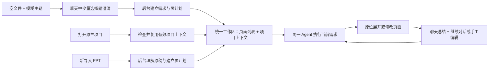

# 内置 AI 助手：聊天驱动的统一 PPT 工作区

状态：统一 AI 工作区产品规范（总追踪 [#10](https://github.com/hyperlook/deckcraft/issues/10)）。M1（共同工作区与页计划）已交付，M2（共享执行成稿与改页）进行中。

本约定替代“独立归纳/确认大纲”旧模式，直接在既有 PPT 工作区内通过聊天澄清需求、原位展示页计划并生成/修改真实页面。

## 1. 产品不是大纲操作台

用户和一个 Agent 在同一个 PPT 工作区持续工作：
- 聊天框表达需求，必要时用少量选择题澄清需求。
- 软件已有的分页列表/缩略图承载页计划、现有页面和生成进度。
- 画布显示真实可编辑页面；页面计划不是另外一套大纲审阅面板。
- Agent 的最终交付是聊天里的简短总结，以及工作区中的实际 PPT 变化。

用户不管理提取、来源快照、JSON、请求身份或内部确认状态。大纲是后台表达计划及页面成形前的自然状态，不是要求用户额外整理或专门验收的独立产品。

## 2. 两种起点，尽早汇合

### 新建起点

用户已经在一个空文件中，不需要先去独立生成器，最后再创建另一个标签。
1. 用户在聊天框输入模糊主题。
2. 系统识别影响内容结构的未知需求，用选择题收敛用途、受众、重点、规模等。
3. 允许推荐项、其他/补充和合理默认，不把固定长问卷交给每个人。
4. 澄清结果成为结构化需求；这一步还不是大纲，也不能冒充原稿事实。
5. 后台形成页计划，出现在当前项目的页面列表，随后进入共享执行流程。

### 打开已有 PPT

系统判断的是“当前项目有没有可用且匹配的上下文”，不是只看文件扩展名：
- 原生项目且上下文有效：复用需求、证据、页计划和已有页面。
- 原生项目缺少、过期或只有旧摘录字段：后台迁移或重建必要部分，不把字段存在当作完整建模。
- 新导入 PPTX：原页立即可见；后台在已获授权范围内提取、理解和建立上下文。
- 已有页面默认不被改动。用户表达修改需求后，才执行相应页面任务。

新建的澄清结果与已有 PPT 的理解结果进入同一项目上下文，不另建两套新建/改页 runtime。

## 3. 页面列表是成果载体

沿用普通视图的分页列表和排序视图，不把它们复制到 AI 侧栏：
- 尚未展开的页显示标题、简要内容或表达意图，并明确“计划页”状态。
- 已有页面保留原缩略图，可附简短概括；用户扫看即可，不要求逐页确认。
- 生成时在同一位置显示工作进度和候选页面；完成后变成真实页面。
- 用户直接在对应页调整意图、内容或顺序，后续 Agent 采用该变化。
- 计划页和真实页有稳定映射；未成稿不伪装已完成，导出不能静默生成空白成品。

“上下文可用”不等于“用户点过确认大纲”，更不意味着模型推断成为事实。必要的页面变更保护与可撤销性保留，但不以独立大纲确认仪式作为每轮前置。

## 4. 聊天是沟通与动作流，不是诊断控制台

聊天内容限于：
- 用户需求及必要的选择题。
- 可折叠的简短工作状态，例如“理解原稿”“组织页面”“生成第 3 页”“检查文本溢出”。
- 必要的缺口、可操作错误和后续选择。
- 本轮最终总结，说明哪些页面改变、未完成什么。

不默认显示模型请求 JSON、原文逐段证据、端点、脚本路径、请求 ID 或原始推理。详细诊断可放开发入口。工具/动作状态来自真实执行事件，不能用假进度代替真实工作。

模型列表自动加载，用户只需选择模型；正常聊天不要求用户先手动“加载 Pi”。认证故障是可操作错误，不是常驻工程说明。

## 5. 后台建模的三个对象

| 对象 | 内容 | 规则 |
|---|---|---|
| 需求与约束 | 用途、受众、规模、风格、用户本轮意见 | 可来自选择题/聊天，不自动当作事实 |
| 原文依据与素材 | 原稿文字、数字、条件、补充来源与读取缺口 | 持续保留来源，不保证现实真实性 |
| 表达计划与页面内容 | 整稿主线、每页职责、最终文案及原生页面 | 计划与正文分开，正文不直接全文回填计划 |

后台负责建立、版本校验、复用和必要更新。手改页面使相关依据/派生状态需要检查，但不静默重写用户已采用的表达方向，也不要求用户手动刷新快照。

首版支持文字依据与受限原生页型，不宣称图片/图表/OCR 已被理解。读取缺口在必要时简短提示；超限不静默截断。空文件使用需求输入，不复用“无原文就禁止归纳”的导入校验。

## 6. 一个共享执行流程

共享 Agent 协调澄清、上下文准备、页计划、生成/改写、真实渲染检查、有限修正和最终总结。新建与修改只是当前页面状态和任务意图不同：
- 计划页：展开成标题/正文等真实原生页面。
- 现有页：根据用户意见修改明确目标。
- 混合文稿：同一页列表中允许计划页与已完成页并存。

Agent 不等于加载通用 coding agent。业务动作必须受限、可校验，宿主绑定文稿/页面目标；模型不能调用任意 engine 命令、shell、文件或网络工具。

工作中可在原页面列表投影隔离草稿。内容校验和变更授权满足后，engine 原子安装本轮结果，形成一个可撤销用户操作；不按 token、工具步骤或每页写入历史。是否需要用户接受取决于本轮任务授权，不规定所有修改都必须另开“接受提案”面板。

取消/失败撤去未提交草稿，保留已有项目；关闭来源文稿或迟到结果不产生写入。目标发生手工变化时不得悄悄覆盖，保留候选并给出简短冲突处理选择，不做首版复杂冲突合并。

## 7. 保存与隐私

- `.deckcraft` 保存用户选择后的需求、证据、表达计划、必要草稿及页面状态/映射；恢复后继续同一工作区。
- PPTX 是导出格式，不保证 AI 项目数据；导出不能伪装项目元数据已安全保存。
- 自动建模不等于自动向模型上传。模型及数据使用告知在设置/首次使用处理，按已授权范围执行，不要求每轮检查 JSON 再勾授权。
- 文稿关闭清理运行期工作副本；运行期 docUid 不是持久缓存身份。
- 凭据、原始推理及无必要的请求快照不进入项目文件/日志/截图。
- Web 无本地桥时普通编辑仍可用；完整独立分发与更多 Provider 是后续能力，不阻塞统一体验设计。

## 8. 产品验收

使用同一版本连续验证：
1. 空文件输入模糊需求 → 选择题 → 原分页列表中的计划页 → 同位置的真实可编辑页。
2. 新导入 PPT → 原页正常可见 → 后台建立上下文 → 聊天要求修改 → 对应页更新。
3. 原生项目重开 → 复用有效上下文 → 继续对话；手改页后的下一轮采用当前状态。
4. 两种起点共享动作流、总结、取消、撤销、保存与错误语义，无额外大纲操作台。
5. 生成任务结束时必须有真实 PPT 变化，不能只给一段大纲便声称完成。

自动测试和 Fake 支持工程回归，不代替真实模型质量与人类体验验收。
